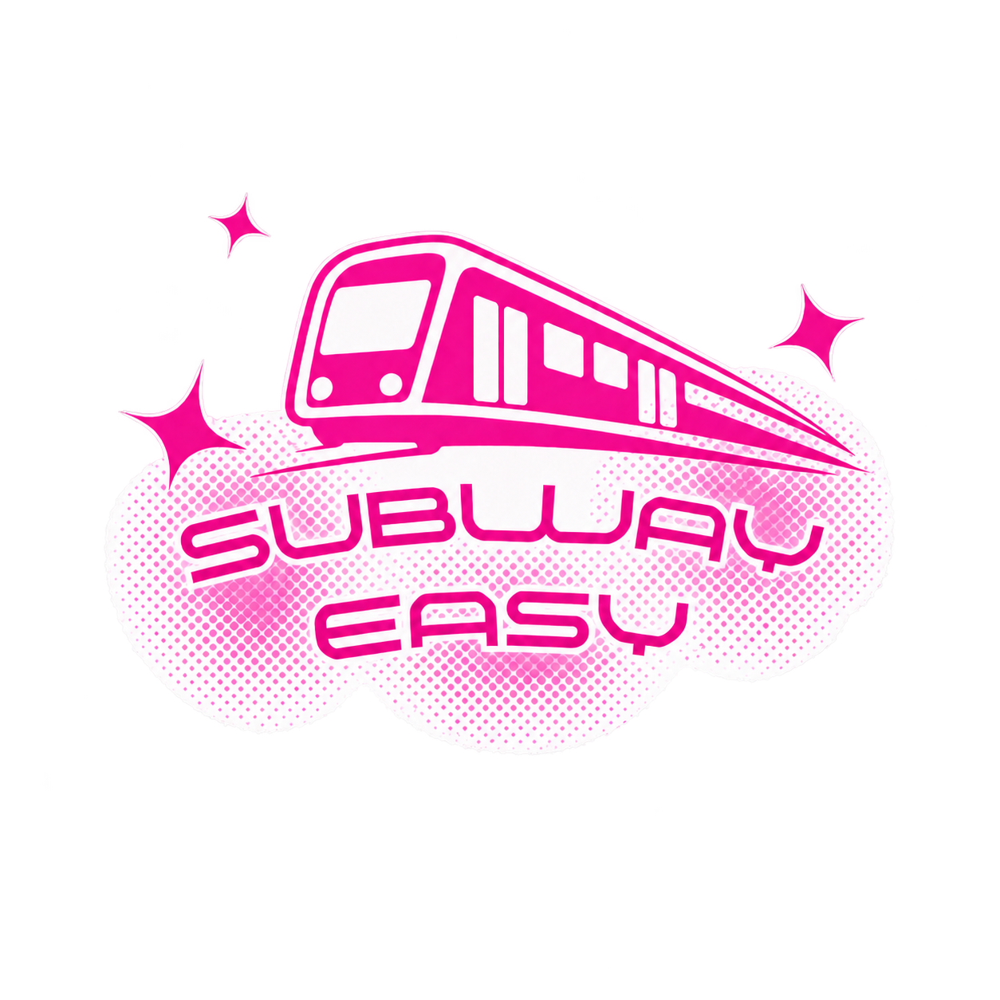

<div align="center">



# SubwayEasy

### 앉고 싶은데, 언제쯤 자리가 날까?

**지하철 하차 예정 정보를 공유하고 검색할 수 있는 웹서비스**

일상 속 작은 불편함에서 출발해 실제 데이터 연동 서비스로 발전시킨 프로젝트입니다.

[서비스 바로가기](https://subwayeasy.pages.dev/) | [GitHub Repository](https://github.com/parkchaerin84/vibe2026)

</div>

---

## 01. 프로젝트 소개

### 기획 배경

> "지금 내 앞에 있는 사람이 어느 역에서 내릴지 알 수 있다면 어떨까?"

지하철을 이용하다 보면 빈자리가 생기기를 기다리는 순간이 있습니다.

같은 열차에 탑승하고 있어도 누가 어느 역에서 내릴지는 알 수 없습니다.

이러한 불편함에서 출발해 승객들이 자신의 하차 예정 정보를 공유하고, 다른 승객들은 원하는 조건에 맞는 정보를 검색할 수 있는 서비스를 기획했습니다.

처음에는 프론트엔드 프로토타입으로 시작했지만, 이후 데이터베이스와 사용자 인증, 공공데이터 API를 연결하며 실제 데이터를 저장하고 조회할 수 있는 웹서비스로 확장했습니다.

### 프로젝트 정보

| 항목 | 내용 |
|---|---|
| 프로젝트명 | SubwayEasy |
| 프로젝트 유형 | 개인 프로젝트 |
| 서비스 형태 | 웹 애플리케이션 |
| 주요 기능 | 하차 정보 공유 및 검색, 편의시설 조회, 커뮤니티 |
| 지원 노선 | 서울 지하철 2호선 중심 |
| Database | PostgreSQL (Supabase) |
| Deployment | Cloudflare Pages |
| 개발 방식 | AI 개발 도구를 활용한 서비스 기획 및 구현 |

---

## 02. 주요 기능

### 2.1 하차 정보 공유

사용자가 자신의 하차 예정 정보를 등록하고 관리하는 기능입니다.

- 현재 역과 하차 예정 역 선택
- 운행 구간 및 이동 방향 선택
- 탑승 칸 번호 선택 (1~10번)
- 본인이 등록한 제보 조회 및 삭제
- 등록 후 30분 자동 만료

**주요 특징**

- 이동 방향에 따라 도달 가능한 역만 선택하도록 검증
- Supabase 익명 인증을 활용한 작성자 식별
- 사용자별 제보 관리 및 접근 권한 구분

### 2.2 하차 정보 검색

다른 사용자가 공유한 하차 예정 정보를 조회하는 기능입니다.

- 현재 유효한 전체 제보 목록 조회
- 운행 구간 및 방향별 검색
- 탑승 칸 번호 필터링
- 하차 예정 역 필터링
- 최신 제보 우선 표시
- 지하철 10칸 시각화

**주요 특징**

- 검색 조건을 지정하지 않아도 전체 제보 확인 가능
- 조건을 선택하면 일치하는 정보만 표시
- 만료된 정보는 검색 결과에서 제외

### 2.3 역별 편의시설 조회

공공데이터 API를 활용해 서울 지하철 2호선의 편의시설 정보를 조회하는 기능입니다.

- 서울 2호선 본선 및 지선 역 조회
- 역별 화장실 위치 정보 제공
- 층 및 출입구 정보 표시
- 공공데이터 기준일 안내
- API 오류와 조회 결과 없음 구분

**주요 특징**

- Cloudflare Pages Functions를 통한 서버 측 API 요청
- API 인증키를 서버 환경변수로 관리
- 캐시를 활용한 불필요한 API 호출 감소

### 2.4 이용자 커뮤니티

이용자들이 지하철 이용 경험과 의견을 공유하는 기능입니다.

- 게시글 작성 및 조회
- 게시글 수정 및 삭제
- 댓글 작성 및 관리
- 분류 및 역별 검색
- 작성자별 접근 권한 관리

게시글과 댓글은 Supabase PostgreSQL에 저장됩니다.

### 2.5 긴급 안내

지하철 이용 중 긴급 상황에서 참고할 수 있는 신고 및 대응 정보를 제공합니다.

실제 신고 접수 기능은 아니며, 공식 철도 운영기관과 연동되어 있지 않습니다.

---

## 03. 기술 스택

| 구분 | 기술 |
|---|---|
| Frontend | Next.js 15, React 19 |
| Language | TypeScript |
| Styling | Tailwind CSS |
| Database | PostgreSQL |
| BaaS | Supabase |
| Authentication | Supabase Anonymous Auth |
| Authorization | Row Level Security (RLS) |
| Serverless | Cloudflare Pages Functions |
| Deployment | Cloudflare Pages |
| External API | 공공데이터포털 API |
| Testing | Node.js Test Runner |
| Development Tools | Claude, Codex, GitHub |

---

## 04. 시스템 아키텍처

```text
                  User
                    |
                    v
             Cloudflare Pages
                    |
              Next.js / React
                    |
          +---------+---------+
          |                   |
          v                   v
       Supabase        Pages Functions
          |                   |
    +-----+-----+             v
    |           |       Public Data API
    v           v
PostgreSQL     Auth
    |           |
    |           +-- Anonymous Authentication
    |
    +-- Seat Shares
    +-- Posts
    +-- Comments
    |
    +-- RLS Authorization
```

### 데이터 처리 흐름

**하차 정보 등록 및 조회**

Client → Supabase SDK → PostgreSQL

**작성자 인증 및 권한 관리**

Client → Supabase Anonymous Auth → RLS

**편의시설 조회**

Client → Cloudflare Pages Functions → 공공데이터 API

외부 API 인증키는 클라이언트에 노출되지 않도록 서버리스 함수에서 관리합니다.

---

## 05. 기술적 문제 해결

### 5.1 사용자별 데이터 접근 권한 관리

**Problem**

하차 정보는 모든 사용자가 조회할 수 있어야 하지만, 다른 사용자가 작성한 제보를 임의로 삭제해서는 안 됩니다.

**Solution**

- Supabase Anonymous Authentication 활용
- 공개 조회와 작성자별 관리 기능 분리
- 작성자별 제보 식별
- Row Level Security 정책을 통한 접근 권한 제어
- 본인 제보에 대해서만 관리 기능 제공

**Learned**

클라이언트에서 삭제 버튼을 숨기는 것만으로는 데이터의 안전성을 보장할 수 없다는 점을 이해했습니다.

데이터베이스 수준에서 접근 권한을 관리하면서 인증과 인가의 차이를 학습했습니다.

---

### 5.2 하차 정보의 유효시간 관리

**Problem**

하차 예정 정보는 시간이 지나면 실제 상황과 맞지 않게 됩니다.

만료된 정보가 계속 노출되면 사용자가 유효하지 않은 정보를 참고할 가능성이 있습니다.

**Solution**

- 제보 생성 시각 및 만료 시각 관리
- 등록 후 30분 만료 정책 적용
- 만료된 정보는 조회 결과에서 제외
- 30초 간격 목록 갱신
- 만료 경계 조건 테스트

**Learned**

데이터는 단순히 저장하는 것뿐 아니라 언제까지 유효한지를 함께 고려해야 한다는 점을 배웠습니다.

---

### 5.3 등록·검색·시각화 간 데이터 불일치 해결

**Problem**

초기 구현에서는 등록 폼에서 1~20번 칸을 허용했지만, 검색과 시각화에서는 1~10번 칸만 지원하는 문제가 있었습니다.

이로 인해 일부 제보가 정상적으로 검색되거나 표시되지 않을 가능성이 있었습니다.

**Solution**

- 노선별 탑승 칸 정책을 공통 모듈로 분리
- 서울 2호선의 탑승 칸을 1~10번으로 통일
- 등록·검색·시각화에 동일한 설정 적용
- 유효하지 않은 번호 및 소수 입력 차단
- 관련 입력 검증 테스트 추가

**Learned**

여러 기능에서 공통으로 사용하는 도메인 규칙은 한곳에서 관리해야 데이터 불일치를 예방할 수 있다는 점을 배웠습니다.

---

### 5.4 외부 API 인증키 보호

**Problem**

공공데이터 API를 클라이언트에서 직접 호출하면 인증키가 브라우저에 노출될 위험이 있습니다.

**Solution**

- Cloudflare Pages Functions 활용
- 외부 API 요청을 서버 측에서 처리
- API 인증키를 Cloudflare Secret으로 관리
- 요청값 및 응답 데이터 검증
- 캐시 적용으로 중복 요청 감소
- 조회 실패와 정상적인 빈 결과 구분

**Learned**

외부 API를 연동할 때는 단순히 데이터를 불러오는 것을 넘어 인증정보 보호, 요청 검증, 오류 처리까지 고려해야 한다는 점을 경험했습니다.

---

## 06. 프로젝트 구조

```text
app/
  page.tsx
  find-seat/
  share-seat/
  facilities/
  community/
  emergency/

components/
  Navbar.tsx
  SeatShareCard.tsx
  SeatShareCars.tsx

lib/
  supabase/
  transit/

functions/
  api/
    facilities/

server/
  facilities.ts

tests/
public/
docs/
```

| 디렉터리 | 역할 |
|---|---|
| app | 페이지 및 화면 구성 |
| components | 공통 UI 컴포넌트 |
| lib/supabase | 인증 및 데이터 접근 |
| lib/transit | 노선·방향·검색·칸 번호 정책 |
| functions | Cloudflare 서버리스 함수 |
| server | 외부 API 요청 처리 |
| tests | 기능 및 회귀 테스트 |
| docs | 기술 문서 |

---

## 07. 테스트 및 검증

### 실행 명령어

```bash
npm install
npm run typecheck
npm test
npm run build
```

### 주요 검증 항목

- 하차 정보 입력값 검증
- 이동 방향 및 도달 가능한 역 검증
- 탑승 칸 번호 범위 검증
- 검색 조건별 필터링
- 30분 만료 정책
- 작성자별 데이터 관리 로직
- 외부 API 응답 및 오류 처리
- API 인증키 노출 방지

### 검증 결과

- 탑승 칸 정책 수정 시점 기준 자동화 테스트 78개 통과
- TypeScript 타입 검사 통과
- 정적 빌드 성공

자동화 테스트와 실제 브라우저에서의 사용자 간 등록·조회·삭제 검증은 구분해 관리합니다.

---

## 08. 개발 과정 및 담당 역할

### 기획 및 설계

- 지하철 이용 중 불편함 발견 및 문제 정의
- 서비스 아이디어 구상
- 핵심 기능 및 요구사항 정의
- 사용자 이용 흐름 설계
- 페이지 구성 및 UI 방향 결정

### 구현 및 검증

- AI 개발 도구를 활용한 코드 생성 및 개선
- 기능별 구현 결과 검토
- 오류 분석 및 수정 요구사항 정의
- 데이터 연동 방식 검토
- 인증 및 접근 권한 구조 학습
- 테스트 결과 확인 및 기능 개선
- GitHub 및 Cloudflare 배포 과정 관리

### AI 도구 활용

이 프로젝트는 Claude와 Codex를 활용해 개발한 개인 프로젝트입니다.

문제 정의, 서비스 기획, 요구사항 작성 및 개선 방향을 직접 결정하고 AI 도구를 코드 생성과 구현 보조에 활용했습니다.

생성된 코드의 동작을 확인하고 문제를 발견하면 수정하는 과정을 반복하며 서비스 개발 전반을 경험했습니다.

---

## 09. 서비스의 한계

- 동일한 노선과 칸 번호라도 같은 열차에 탑승했다는 의미는 아닙니다.
- 공유된 하차 정보가 실제 빈 좌석 발생을 보장하지 않습니다.
- 사용자의 자발적인 참여가 필요합니다.
- 공공데이터는 실제 시설 운영 현황과 차이가 있을 수 있습니다.
- 공식 철도 운영기관과 연계된 서비스가 아닙니다.

---

## 10. 프로젝트 회고

처음에는 평소 지하철에서 느꼈던 작은 불편함을 해결하고 싶다는 생각에서 출발했습니다.

아이디어를 실제로 접속 가능한 웹서비스로 발전시키면서 기획, 구현, 데이터 연동, 테스트, 배포까지 전체 과정을 경험할 수 있었습니다.

특히 사용자 간 데이터를 공유하는 기능을 만들면서 인증과 접근 권한, 데이터 유효기간, 입력값 검증이 중요하다는 점을 알게 되었습니다.

AI 개발 도구를 활용하는 과정에서도 생성된 결과를 그대로 받아들이기보다 동작을 확인하고 문제를 발견하면 수정하는 과정이 중요하다는 점을 배웠습니다.

앞으로도 일상 속 불편함을 발견하고 기술로 해결하는 개발자로 성장하고 싶습니다.

---

<div align="center">

**SubwayEasy**

지하철의 작은 불편을 함께 덜어가는 서비스

[서비스 바로가기](https://subwayeasy.pages.dev/)

</div>
